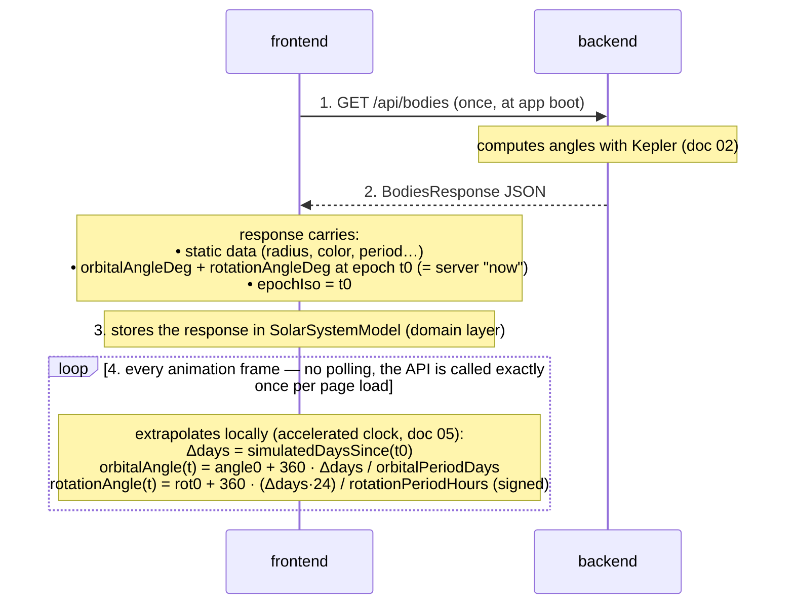

# 01 — Architecture & Tooling

## Monorepo layout

pnpm workspace with three packages under `packages/` — two apps and one shared library:

```
solar-3d/
├── CLAUDE.md
├── docs/
├── package.json              # root: scripts + devDeps shared tooling
├── pnpm-workspace.yaml
├── tsconfig.base.json        # shared compiler options, packages extend it
├── wrangler.jsonc            # Cloudflare Workers deployment descriptor (see Deployment below)
├── .gitignore                # node_modules, dist, .env — do NOT ignore packages/frontend/public/textures
├── scripts/
│   └── download-textures.mjs # one-shot dev script (see doc 08)
└── packages/
    ├── shared/               # @solar/shared — API DTO types only (zero runtime code)
    │   ├── package.json
    │   ├── tsconfig.json
    │   └── src/
    │       ├── index.ts
    │       └── bodies.ts     # BodyDto, BodiesResponse, BodyType…
    ├── backend/              # @solar/backend — Hono API, deployed as a Cloudflare Worker
    │   ├── package.json
    │   ├── tsconfig.json
    │   └── src/              # layout detailed in doc 02
    └── frontend/             # @solar/frontend — Vite + React + Three.js
        ├── package.json
        ├── tsconfig.json
        ├── index.html
        ├── public/
        │   └── textures/     # committed assets (doc 08)
        └── src/              # layout detailed in doc 04
```

### pnpm-workspace.yaml

```yaml
packages:
  - "packages/*"
```

### Package names and dependencies

| Package | Name | Depends on |
|---|---|---|
| `packages/shared` | `@solar/shared` | — (types only, no runtime deps) |
| `packages/backend` | `@solar/backend` | `@solar/shared` (workspace:\*), `hono`; dev: `@hono/node-server`, `tsx` |
| `packages/frontend` | `@solar/frontend` | `@solar/shared` (workspace:\*), `react`, `react-dom`, `three` |

`@solar/shared` is consumed **as TypeScript source** (its `main`/`exports` points to `src/index.ts`). No build step for it; both apps' bundler/runtime compile it. This avoids build-order problems for a POC.

## Root package.json scripts

```jsonc
{
  "scripts": {
    "dev": "concurrently -n api,web -c blue,green \"pnpm --filter @solar/backend dev\" \"pnpm --filter @solar/frontend dev\"",
    "build": "pnpm -r build",
    "deploy": "pnpm --filter @solar/frontend build && wrangler deploy",
    "dev:worker": "wrangler dev --port 3001 --var ISS_TLE_OFFLINE:1",
    "test": "pnpm -r test",
    "lint": "pnpm -r lint",
    "typecheck": "pnpm -r typecheck",
    "download-textures": "node scripts/download-textures.mjs"
  }
}
```

`concurrently` and `wrangler` are root devDependencies.

## Tooling versions

| Tool | Version | Notes |
|---|---|---|
| Node | 24 (≥ 24.22.1) | use built-in `fetch` in scripts; add `"engines": { "node": ">=24.22.1" }` to the root package.json (24.22.1 fixes the October 2026 security release, incl. CVE-2026-111497) |
| pnpm | ≥ 9 | |
| TypeScript | ^5.x | `strict: true` everywhere (doc 07) |
| Vite | ^5.x | frontend dev server + build |
| React | ^18.x | |
| three | ^0.160.0 or newer | import addons from `three/examples/jsm/...` |
| Hono | ^4.x | backend web framework — runs unchanged on Workers and Node |
| Wrangler | ^4.x | Cloudflare CLI: `wrangler deploy`, `wrangler dev` |
| Vitest | ^1.x or ^2.x | test runner for **both** apps and shared |
| tsx + @hono/node-server | ^4.x / ^1.x | local backend dev runner (`tsx watch src/dev.ts`) |
| ESLint + Prettier | latest | config in doc 07 |

## Ports & proxy

- Backend listens on **3001** (`http://localhost:3001`).
- Frontend dev server on **5173** (Vite default).
- Vite proxies `/api` → `http://localhost:3001` so the frontend always calls relative `/api/bodies`:

```ts
// packages/frontend/vite.config.ts
export default defineConfig({
  plugins: [react()],
  server: { proxy: { "/api": "http://localhost:3001" } },
});
```

- No CORS: in dev the Vite proxy, in production the single Worker, keep the frontend and the API on the same origin.

## Deployment (Cloudflare Workers)

A **single Worker** serves everything, described by the root `wrangler.jsonc` — it deploys the whole app, so it lives at the repo root (also where Workers Builds looks for it):

- `routes: [{ pattern: "solar.jynfra.com", custom_domain: true }]` — the app's only public URL (the `jynfra.com` zone is on Cloudflare, which creates the DNS record and certificate); `workers_dev: false` and `preview_urls: false` so no `*.workers.dev` URL exposes it too.
- `main: "packages/backend/src/worker.ts"` — the Hono app; `assets.directory: "packages/frontend/dist"` — the Vite build.
- `assets.not_found_handling: "single-page-application"` so path routes (`/earth`, doc 06) return `index.html`; `assets.run_worker_first: ["/api/*"]` so the API always reaches the Worker.
- `vars`: `ISS_TLE_OFFLINE: "0"` (production is the only place that fetches the TLE), `LOG_LEVEL: "info"`.
- `kv_namespaces`: `TLE_CACHE` — the persistent ISS TLE cache (doc 02 step E); namespace provisioned by wrangler on the first deploy, its `id` committed in `wrangler.jsonc`.
- `observability.enabled: true` — logs land in Workers Logs.

`pnpm run deploy` builds the frontend then runs `wrangler deploy`. Local development does **not** need workerd: `pnpm dev` runs the same Hono app on Node (`packages/backend/src/dev.ts`, `@hono/node-server`), with a file-backed `TLE_CACHE` in `.cache/`. `pnpm dev:worker` runs `wrangler dev` (API only, :3001) instead, on hosts where workerd works (it does not on 39-bit-VA kernels such as Raspberry Pi OS).

## Runtime data flow



Key consequence for implementers: **the backend gives a snapshot; all motion is computed client-side** in the domain layer from periods. The Kepler math lives only in the backend.

> **ISS exception (v3, S23).** The ISS's elements come from a live TLE, not a static table: at most **once per 24 h** the backend GETs the CelesTrak TLE (native `fetch`, lazy in-memory cache, committed snapshot as offline fallback — doc 02 step E). This is the **only** external request in the whole system; the frontend still calls exactly one origin (`/api`), exactly once per page load. The ISS snapshot in the response is extrapolated client-side like any moon; a page refresh re-anchors it.

## What is NOT in the architecture

- No database, no env-dependent config (hardcode ports above). No cache, except the single in-memory 24 h TLE cache above (no cache library — a module-level variable).
- No Docker, no CI pipeline (out of scope for the POC).
- No shared runtime utilities package — `@solar/shared` contains **types only**. If you feel the urge to share a function, copy it; do not grow the shared package.
